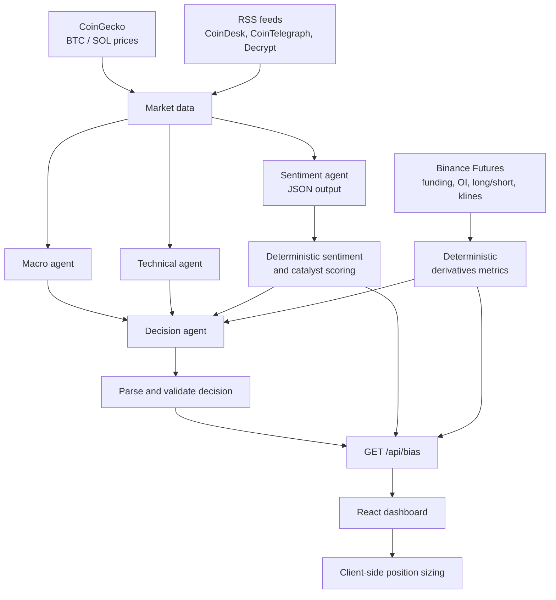
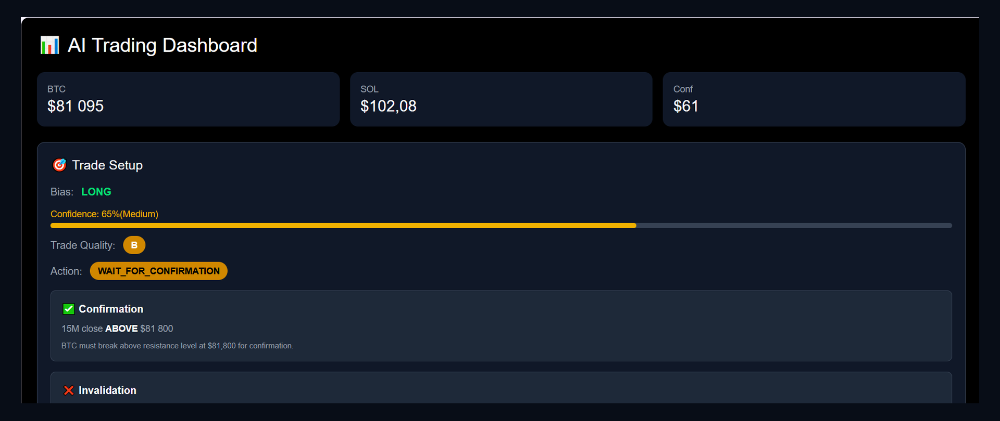
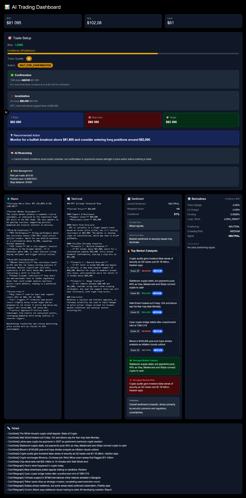

# APIB V1 — AI Trading Analysis Dashboard

APIB V1 is a single-page Next.js dashboard that combines live crypto market data, news headlines, and four OpenAI-powered analysis steps into one structured BTC trade-setup view. It pairs LLM analysis with deterministic TypeScript logic (sentiment weighting, catalyst scoring, derivatives metrics, and position sizing) so that part of the output is reproducible and testable.

> **Disclaimer:** This is an educational / portfolio project. It is **not financial advice** and not a trading system. See [Disclaimer](#disclaimer).

## Table of Contents

- [Features](#features)
- [Architecture](#architecture)
- [Deterministic Logic](#deterministic-logic)
- [Tech Stack](#tech-stack)
- [Project Structure](#project-structure)
- [Getting Started](#getting-started)
- [NPM Scripts](#npm-scripts)
- [Implementation Status](#implementation-status)
- [Known Limitations](#known-limitations)
- [Screenshots](#screenshots)
- [Disclaimer](#disclaimer)

## Features

The dashboard (`app/page.tsx`) loads `GET /api/bias` once on page load and renders:

- **Price cards** — BTC and SOL spot prices (CoinGecko) and the sentiment confidence value.
- **Trade setup** — bias (LONG / SHORT / NEUTRAL), confidence bar, trade quality grade (A/B/C), action (`LONG_READY`, `SHORT_READY`, `WAIT_FOR_CONFIRMATION`, `NO_TRADE`), confirmation and invalidation conditions, planned entry, stop loss, target, recommended action, and reasoning.
- **Risk management** — risk amount, position size, and stop distance computed from the AI-proposed entry and stop.
- **AI agent analysis grid** — Macro, Technical, Sentiment, and Derivatives cards.
- **Sentiment** — overall label, weighted score, confidence, intraday and short-term bias, and a summary from headline-level analysis.
- **Catalysts** — the top 5 non-duplicate headlines, ranked by a deterministic score with direction and priority.
- **Derivatives** — Binance Futures funding, long/short ratio, open-interest change, price change, positioning, crowding risk, and a derived signal.
- **News** — the recent crypto headlines used as input.

## Architecture



Request flow in `app/api/bias/route.ts`:

1. Check that `OPENAI_API_KEY` is set and create the OpenAI client for the request.
2. Fetch BTC/SOL prices (CoinGecko) and headlines (RSS, up to 15) in parallel. If no BTC price is available, return an empty-shaped fallback response.
3. Run three `gpt-4o-mini` calls in parallel: **Macro** and **Technical** (free text) and **Sentiment** (JSON mode, parsed and validated).
4. Fetch Binance Futures data and compute derivatives metrics deterministically.
5. Recompute the sentiment score and label deterministically, and build ranked catalysts.
6. Run the final **Decision Agent** (`gpt-4o-mini`, JSON mode) with the macro, technical, sentiment, and derivatives context, then parse and validate its output.
7. Return a single typed `BiasResponse` JSON object to the React dashboard.

### Data sources

| Source | Data | Code |
|---|---|---|
| CoinGecko | BTC and SOL USD prices | `lib/market-data.ts` |
| CoinDesk, CoinTelegraph, Decrypt RSS | Headlines | `lib/news.ts` |
| Binance Futures (BTCUSDT) | Open interest, funding rate, global long/short ratio, OI history, 15m klines | `lib/market-data/derivatives.ts` |
| OpenAI | Analysis and decision | `app/api/bias/route.ts`, `lib/prompts.ts` |

## Deterministic Logic

These parts do not depend on the LLM:

- **Weighted sentiment** (`lib/sentiment/`) — each non-duplicate, in-range headline score is weighted by `(btcRelevance / 10) × (confidence / 100)`. The weighted average is clamped to −100…+100 and mapped to one of seven labels (`STRONGLY_BEARISH` … `STRONGLY_BULLISH`).
- **Catalyst scoring** (`lib/catalyst/`) — score = 35% BTC relevance + 30% sentiment strength + 20% confidence + 15% impact. The score maps to a priority (`LOW`, `MEDIUM`, `HIGH`, `CRITICAL`), and the sentiment sign maps to a direction (`BULLISH`, `BEARISH`, `NEUTRAL`).
- **Derivatives metrics** (`lib/market-data/deriveDerivativeMetrics.ts`) — funding bias, long/short bias, open-interest and price change, a price/OI positioning state, a crowding-risk rule, and a derived signal (`BULLISH`, `BEARISH`, `CAUTION`, `NEUTRAL`) with a heuristic confidence.
- **Trade quality** (`lib/decision/calculateTradeQuality.ts`) — grade A, B, or C derived from confidence and action. See [Known Limitations](#known-limitations).
- **Position sizing** (`lib/risk.ts`):

  ```text
  riskAmount   = accountSize × (riskPercent / 100)
  stopDistance = |entry − stopLoss|
  positionSize = riskAmount / stopDistance
  ```

  The dashboard currently uses hard-coded inputs of an account size of 700 and a risk of 2% per trade. Sizing returns nothing if the stop distance is zero.

The thresholds above are heuristic design choices, not validated or optimized parameters.

## Tech Stack

- **Framework:** Next.js 16.4.2 (App Router), React 19.2.3
- **Language:** TypeScript (strict mode)
- **Styling:** Tailwind CSS v4
- **AI:** OpenAI Node SDK (`gpt-4o-mini`)
- **Tooling:** ESLint 9 (`eslint-config-next`)

## Project Structure

```text
app/
  layout.tsx              Root layout
  page.tsx                Dashboard page (client component)
  api/bias/route.ts       Orchestration endpoint: GET /api/bias
components/trading/       Dashboard UI cards (trade setup, agents, catalysts, derivatives, news)
lib/
  market-data.ts          CoinGecko prices and headline aggregation
  news.ts                 RSS fetching
  prompts.ts              Prompts for the four AI calls
  risk.ts                 Position-sizing calculation
  hooks/useTradeData.ts   Client hook that calls /api/bias
  sentiment/              Sentiment parsing, weighting, and labels
  catalyst/               Catalyst scoring, direction, and priority
  decision/               Decision types, parsing, and trade quality
  market-data/            Binance derivatives, derived metrics, and spot flow
  types/bias.ts           API response contract (BiasResponse)
```

## Getting Started

### Prerequisites

- A Node.js version supported by Next.js 16 (check the Next.js documentation for the current minimum) and npm
- An OpenAI API key (usage is billed by OpenAI)

### Setup

```bash
git clone <repository-url>
cd apib-v1
npm install
```

Create a `.env.local` file in the project root:

```bash
OPENAI_API_KEY=your_openai_api_key_here
```

Start the dev server and open <http://localhost:3000>:

```bash
npm run dev
```

`.env.local` is ignored by Git. Never commit real API keys. If the key is missing, `/api/bias` returns HTTP 500 with an empty-shaped response and the dashboard stays in its empty state.

## NPM Scripts

| Script | Command | Purpose |
|---|---|---|
| `npm run dev` | `next dev` | Start the development server |
| `npm run build` | `next build` | Create a production build |
| `npm run start` | `next start` | Run the production build |
| `npm run lint` | `eslint` | Lint the project |

## Implementation Status

**Implemented**

- Dashboard UI: trade setup, risk card, agent grid, sentiment, catalysts, derivatives, news.
- `/api/bias` orchestration with the Macro, Technical, Sentiment, and Decision agents.
- Deterministic sentiment weighting, catalyst scoring, derivatives metrics, and position sizing.
- Fallbacks: failed price or news fetches return zero or placeholder values, failed Binance calls return null or empty data, unparseable AI JSON becomes `null`, and agent errors return default strings (the decision agent defaults to `NO_TRADE`).

**Experimental / partial**

- **Spot Flow** (`lib/market-data/spot-flow.ts`) — Binance spot aggregated-trade metrics are fetched and logged in the API route only.
- **Deterministic Trade Quality** — calculated and compared with the AI-provided grade in logs only.

## Known Limitations

- Spot Flow is not integrated into the final decision or the UI.
- Deterministic Trade Quality is currently used for comparison and logging only. The UI shows the grade returned by the Decision Agent.
- No automated trade execution, backtesting, persistence, or automated tests.
- No authentication, rate limiting, or caching on `/api/bias`. Each page load triggers the full pipeline.
- Live OpenAI calls incur API costs (four calls per request).
- The dashboard fetches data once on load, with no refresh or polling and no dedicated error state in the UI.
- Position-sizing inputs (account size and risk percent) are hard-coded in `app/page.tsx`.
- Output quality depends on LLM responses and third-party data availability; no reliability or performance guarantees are made.
- The project has not been hardened for production use.

## Screenshots

### Dashboard overview



### Full dashboard



## Disclaimer

This project is for educational and portfolio purposes only. Nothing it produces is financial, investment, or trading advice. It has no proven trading performance. Do not use it to make real trading decisions. Use at your own risk.
